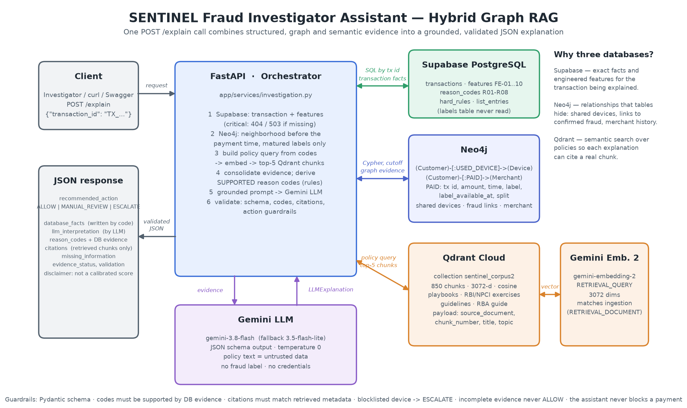

# SENTINEL Fraud Investigator Assistant: Hybrid Graph RAG

An API that explains **why a payment looks risky** and **what an investigator should check**. Every statement is
tied to evidence retrieved from three existing databases:

- **Supabase PostgreSQL:** the transaction and its engineered features.
- **Neo4j:** the customer, device and merchant relationships around it.
- **Qdrant Cloud:** the fraud-investigation policies that apply.

```text 
- Combine structured, graph, and semantic retrieval into a Hybrid Graph RAG pipeline.
- Generate a grounded, explainable fraud investigation response using an LLM. 
```


A Gemini LLM turns that evidence into a structured, validated JSON explanation.

## 1. Problem

A fraud investigator looking at a flagged payment has to:
1. pull up the transaction and its risk features,
2. look at who else uses the same device and whether any of them committed fraud before, and
3. find the relevant playbook or regulatory guidance.

Those three answers live in three systems. SENTINEL gathers them in one call and asks an LLM to explain the case using
**only** that evidence, with citations an auditor can check. It recommends `ALLOW`, `MANUAL_REVIEW` or `ESCALATE`.
It never blocks a payment itself.

## 2. Architecture



`POST /explain` → `InvestigationService.explain()` (`app/services/investigation.py`):

1. **Supabase:** transaction, features FE-01 to FE-10, stored reason codes R01 to R08, and active hard-rule hits. This step is
   critical: an unknown ID returns 404 and a database outage returns 503.
2. **Neo4j:** the customer's neighborhood **as it was just before this payment**: prior payments, other customers on
   the same device, the customer's other shared devices, earlier confirmed fraud, and the merchant's fraud rate.
3. **Qdrant:** a natural-language question is built from the supported reason codes, embedded with Gemini Embedding 2,
   and used to retrieve the top-5 policy chunks.
4. **Consolidate:** the code builds `investigation_context = {"transaction", "graph_evidence", "policy_evidence"}` and
   derives the set of **supported reason codes** with deterministic rules.
5. **LLM:** Gemini returns JSON constrained to a Pydantic schema.
6. **Validate:** codes the evidence does not support are dropped, citations that were not retrieved are dropped, and
   the action guardrails are applied.

## 3. What "Hybrid Graph RAG" means here

| Retrieval type | Source | Answers |
|---|---|---|
| Structured | Supabase SQL by primary key | What exactly happened? (amount, channel, time, features) |
| Graph | Neo4j Cypher around the customer | Who and what is this payment connected to, and were those connections involved in fraud before? |
| Semantic | Qdrant vector search | What does policy say to check for these signals? |

Classic RAG would only search documents. Here, the graph and structured evidence decide **what to search for**
(the policy query is built from the supported reason codes) and **what the LLM may claim**.

## 4. Why all three databases are needed

- **Supabase** holds the facts that must be exact: amounts, timestamps and the feature values behind each reason code.
  Vectors cannot give you "amount_to_avg_ratio = 14.26".
- **Neo4j** answers relationship questions that need multi-hop joins over time, such as "which other customers paid with
  this device in the 7 days before this payment, and did any of them commit fraud that was already confirmed at the
  time?" These are cheap traversals in a graph and awkward self-joins in SQL.
- **Qdrant** finds guidance by meaning. "Several people paying from one phone" matches the *shared devices* playbook
  even though the wording differs. Its payload (`source_document`, `chunk_number`) is what makes each citation checkable.

## 5. Project structure

```text
SENTINEL_Investigator_Assistant/
├── app/
│   ├── main.py                    FastAPI app, wiring of clients (build_service)
│   ├── config.py                  pydantic-settings, secrets as SecretStr
│   ├── api/routes.py              POST /explain, GET /health, error mapping
│   ├── db/
│   │   ├── supabase_db.py         get_transaction()  - read-only psycopg, parameterized SQL
│   │   ├── neo4j_db.py            get_customer_neighborhood()  - time-cutoff Cypher
│   │   ├── qdrant_db.py           read-only search on sentinel_corpus2
│   │   └── errors.py              DatabaseUnavailable
│   ├── services/
│   │   ├── investigation.py       orchestrator + validation + guardrails
│   │   ├── reason_codes.py        reason-code catalog and "supported" rules
│   │   ├── policy_retriever.py    query builder, Gemini embedder, search_policy()
│   │   └── llm_service.py         Gemini JSON output, retries, model fallback
│   ├── models/schemas.py          request, LLM output and API response models
│   └── prompts/investigator_prompt.py
├── scripts/load_graph_from_supabase.py   one-off graph load (reuses the Neo4j project's loader)
├── tests/                         pytest: unit tests with fakes + opt-in live integration tests
├── evaluation/                    10-transaction and Hit@5 evaluations, saved results, summary
├── docs/architecture.png          diagram (docs/make_architecture_diagram.py regenerates it)
├── Dockerfile                     two-stage image: runtime deps + app/ only (section 17)
├── .dockerignore                  keeps .env, tests, evaluation and docs out of the build
├── .env.example
└── pyproject.toml
```

## 6. Existing projects reused, and one data fix

| Project | What is reused |
|---|---|
| `supabase_db_kit` | Schema (`sql/01_create_tables.sql`), the stored `features.reason_codes` (R01 to R08, `sql_scripts_report/11_reason_codes.sql`), hard rules and lists. Connection via `DATABASE_URL`. |
| `NEO4J_Graph_CustMerchDevice` | Graph model and all loading code in `graph_loader.py` (imported, not copied). The query patterns from `queries.py` (shared devices in 7 days, 2-hop fraud, merchants on shared devices) were reworked into customer-scoped, time-bounded queries. |
| `QUADRANTDB_EMBEDDING` | Collection `sentinel_corpus2` (read-only) and its exact embedding settings: `gemini-embedding-2`, 3072 dims, cosine distance, `RETRIEVAL_DOCUMENT` for chunks → `RETRIEVAL_QUERY` for queries. |

**Identifier mapping fix.** The existing Neo4j graph had been loaded from a *different generation* of the SENTINEL data:
- none of its 31,937 `PAID.transaction_id` values exist in Supabase;
- customer IDs that appear in both mostly refer to different people (different age, city and region).

Graph evidence therefore could not be attached to a Supabase transaction. With the owner's approval, the same graph model
was loaded from the Supabase kit's data into a **separate** Neo4j container (port 7688). The original graph is untouched.
The loader then checks every edge against Supabase:
`supabase=110,000 graph=110,000 missing=0 extra=0 mismatched=0`.
It also adds `label_available_at` and `split` to each `PAID` edge, which the leakage rules below rely on.

## 7. Installation (Windows PowerShell)

Requires Python 3.11+, [uv](https://docs.astral.sh/uv/) and Docker Desktop.

```powershell
cd C:\tmp\sentinel\SENTINEL_Investigator_Assistant
uv sync
Copy-Item .env.example .env      # then fill in the values (section 8)
```

**Neo4j for this project** (once). It uses a separate container so the original graph stays untouched:

```powershell
$pw = (Select-String -Path .env -Pattern '^NEO4J_PASSWORD=(.*)$').Matches.Groups[1].Value
docker run -d --name sentinel-neo4j-rag -p 7475:7474 -p 7688:7687 `
  -v sentinel_rag_neo4j_data:/data -e NEO4J_AUTH="neo4j/$pw" neo4j:5.26
uv run python scripts/load_graph_from_supabase.py      # ~75 s, safe to re-run, verifies against Supabase
```

## 8. Environment variables

| Variable | Meaning |
|---|---|
| `SUPABASE_DB_URL` | Postgres connection string (Supabase Dashboard → Connect → Session pooler). Used read-only. |
| `SUPABASE_URL`, `SUPABASE_PUBLISHABLE_KEY` | Project URL and publishable key (kept for completeness; the API uses SQL). |
| `NEO4J_URI`, `NEO4J_USER`, `NEO4J_PASSWORD` | The graph from section 7 (`bolt://localhost:7688`). |
| `QDRANT_URL`, `QDRANT_API_KEY`, `QDRANT_COLLECTION` | Qdrant Cloud; collection `sentinel_corpus2`. |
| `GEMINI_API_KEY`, `EMBEDDING_MODEL` | Gemini key and `gemini-embedding-2` (must match ingestion). |
| `LLM_PROVIDER`, `LLM_MODEL`, `LLM_API_KEY`, `LLM_FALLBACK_MODELS` | `gemini`; primary model; key (falls back to `GEMINI_API_KEY`); JSON list of models tried when the primary is overloaded. |
| `LOG_LEVEL` | e.g. `INFO`. |

`.env` is git-ignored. Credentials are held as `SecretStr`, never logged, and never placed in prompts. Database
errors are reported by exception type only, so connection strings never leak into responses.

## 9. Run the API

```powershell
uv run uvicorn app.main:app --reload
```

- Swagger UI: <http://127.0.0.1:8000/docs>
- Health check of all three databases: <http://127.0.0.1:8000/health>. It returns 200 with point and row counts, or 503
  naming the failing store.

## 10. Example request and response

```powershell
curl.exe -X POST "http://127.0.0.1:8000/explain" `
  -H "Content-Type: application/json" `
  -d '{\"transaction_id\":\"TX_0000093205\"}'
```

Add `"include_trace": true` to also receive the full retrieved evidence (transaction, graph, chunks, raw LLM output and
per-step timings).

Real response for a validation transaction (shortened where marked `...`):

```json
{
  "transaction_id": "TX_0000093205",
  "recommended_action": "MANUAL_REVIEW",
  "insufficient_evidence": false,
  "database_facts": [
    "Transaction TX_0000093205: INR 5656.56 via card to electronics merchant M_73fa75978cd80349 (Synthetic Merchant 000114) at 2025-12-19T06:56:45.840000+00:00 (IST hour 12).",
    "Device D_b2ce2ac14d0d4b7a (mobile); is_new_device=True, distinct_customers_per_device_7d=0.",
    "..."
  ],
  "supported_reason_codes": ["R01_NEW_DEVICE", "R02_GEO_MISMATCH", "R08_HIGH_RISK_MCC"],
  "reason_codes": [
    {
      "code": "R01_NEW_DEVICE",
      "description": "Device not seen for this customer in the prior 90 days",
      "source": "supabase.features",
      "evidence": "is_new_device=True, device_id=D_b2ce2ac14d0d4b7a",
      "llm_explanation": "The device D_b2ce2ac14d0d4b7a was not seen for this customer in the prior 90 days (is_new_device=True)."
    },
    "..."
  ],
  "llm_interpretation": {
    "risk_level": "MEDIUM",
    "summary": "The transaction exhibits multiple risk signals including a new device usage, a geographic distance of 1172.56 km between the customer and merchant, and an electronics merchant category. ...",
    "investigation_steps": ["Verify whether the customer is currently traveling between Pune and Delhi.", "..."]
  },
  "citations": [
    {
      "source_document": "DOC_playbooks_0000001", "chunk_number": 2,
      "title": "Internal teaching playbook 0001 on device change",
      "document_type": "playbooks", "topic": "device change", "rank": 1, "score": 0.7649,
      "how_it_applies": "Instructs to escalate combinations of signals according to active policy and check whether travel, shared device, or purchase cycles explain the pattern."
    }
  ],
  "missing_information": ["No calibrated fraud model score is available for this payment.", "..."],
  "evidence_status": {"transaction": "ok", "features": "ok", "graph": "ok", "policy": "ok"},
  "validation": {"removed_reason_codes": [], "removed_citations": [], "action_adjustments": [], "llm_attempts": 2},
  "models": {"llm": "gemini-3.8-flash", "embedding": "gemini-embedding-2",
             "qdrant_collection": "sentinel_corpus2", "llm_used": "gemini-3.5-flash-lite"},
  "processing_time_ms": 8385,
  "disclaimer": "Decision support only. ... it is not a calibrated fraud probability. SENTINEL never blocks payments: a human investigator decides."
}
```

| Status | When |
|---|---|
| 200 | Explanation produced (possibly with `insufficient_evidence: true`) |
| 404 | Transaction ID not in Supabase |
| 422 | Invalid request (the ID must be 1 to 64 characters `[A-Za-z0-9_-]`) |
| 502 | No LLM model produced a valid JSON explanation |
| 503 | Supabase unavailable (nothing can be explained without the transaction) |

## 11. Reason-code catalog

Codes are **derived by code from database values**. The LLM may only choose among the codes marked supported for that
transaction.

| Code | Source | Fires when |
|---|---|---|
| R01_NEW_DEVICE … R08_HIGH_RISK_MCC | `features.reason_codes` (Supabase) | Stored by the SENTINEL feature pipeline: new device, geo mismatch (new city or >500 km), night hour IST, ≥3 failed attempts in 24h, amount ≥5× 90-day average, account <30 days, ≥4 attempts in 1h, electronics/gaming/gift-card merchant |
| G01_SHARED_DEVICE | Neo4j | ≥2 other customers paid with this device in the 7 days before |
| G02_FRAUD_LINKED_DEVICE | Neo4j | Another customer made an already-confirmed fraud payment on a device this customer uses |
| G03_PRIOR_CONFIRMED_FRAUD | Neo4j | The customer has an earlier payment whose fraud label was already available |
| G04_MERCHANT_ELEVATED_FRAUD | Neo4j | Merchant's confirmed fraud rate is ≥3× the all-merchant rate in the window (≥3 fraud payments) |
| HR_BLOCKLIST_DEVICE / HR_ALLOWLIST_CUSTOMER | `hard_rules` + `list_entries` | Device on the blocked list / customer on the allowlist, effective at the transaction time |

**Action guardrails** (applied after the LLM, recorded in `validation.action_adjustments`):
- A blocklisted device becomes `ESCALATE`. The hard rule says BLOCK, but a human applies it.
- An allowlisted customer is capped at `MANUAL_REVIEW` (the blocklist takes precedence).
- Incomplete evidence (graph or policy store unavailable, or no features) is never `ALLOW`.

## 12. Evaluation

```powershell
uv run python evaluation/evaluate_retrieval.py
uv run python evaluation/evaluate_transactions.py            # add --base-url http://127.0.0.1:8000 for a live server
```

Results and discussion are in [`evaluation/evaluation_summary.md`](evaluation/evaluation_summary.md).

**Ten validation transactions** (5 fraud and 5 genuine, picked with `random.Random(42)`):

| Metric | Result |
|---|---|
| Successful / errors | 10 / 0 |
| Evidence-grounding failures | 0 |
| Citation-validation failures | 0 |
| Fraud flagged | 5 / 5 |
| Genuine allowed | 1 / 5 |

The assistant over-escalates: in this synthetic data the feature signals overlap heavily between fraud and genuine
payments. Ten cases do not measure accuracy, and the recommendation is not a calibrated prediction.

**Policy retrieval Hit@5** (methodology in section 13):

| | Document-level | Chunk-level |
|---|---|---|
| App configuration | **90%** (9/10) | **90%** (9/10) |

Every hit was at rank 1. The one miss is a label-maturity question that retrieved "payment retries" documents.

## 13. Hit@5 methodology

- 10 plain-language questions (`evaluation/retrieval_questions.json`), not tuned to the corpus wording.
- For each question one or two **answer phrases** were read from the corpus. Expected evidence is every chunk in
  `sentinel_corpus2` whose text contains the phrase. The script re-checks this against the live collection before scoring.
- **Document-level hit:** a top-5 result comes from a document containing the phrase.
  **Chunk-level hit:** the retrieved chunk itself contains the phrase.
- `Hit@5 = questions with ≥1 relevant result in the top 5 / 10`. Ranks, scores, point IDs and document names are saved
  in `evaluation/retrieval_results.json`.
- The corpus is built from templates (7 near-identical documents per topic), so document-level relevance is effectively
  topic-level relevance.

## 14. Hallucination-reduction strategy

1. **The LLM sees only retrieved evidence.** The prompt contains the transaction, graph evidence, supported codes and
   policy chunks, and nothing else.
2. **Facts and interpretation are separated.** `database_facts` and each reason code's `evidence` are written by code
   from the database rows. Only `llm_interpretation`, `llm_explanation` and `how_it_applies` come from the LLM.
3. **Reason codes are checked against evidence.** Codes outside the deterministic "supported" set are removed and listed in
   `validation.removed_reason_codes`.
4. **Citations are checked against retrieval.** A citation must match a retrieved `(source_document, chunk_number)`. Title,
   score and rank are copied from Qdrant metadata, never from LLM text.
5. **The output schema is enforced.** Gemini's JSON-schema mode is used, Pydantic validates the result again, and an
   invalid reply is retried once. If nothing is valid the API returns 502; it never invents an answer.
6. **Retrieved text is untrusted.** Policy chunks are wrapped in `<policy_chunk>` tags and declared to be data, not
   instructions.
7. **Labels cannot leak.** The target's `fraud_label` is never read. Graph queries use only payments **before** the
   transaction, and only labels that were **already available** then (`label_available_at <= cutoff`) from the
   warmup/train splits. Validation and holdout labels never appear as evidence. A unit test checks the prompt contains no
   `fraud_label`.
8. **Missing evidence is reported.** `evidence_status`, `insufficient_evidence` and `missing_information` say what was
   missing, and incomplete evidence cannot lead to `ALLOW`.
9. **Every request is traceable.** Each request logs its codes, citations, removals and timings, and `include_trace: true`
   returns the full evidence.
10. **No secrets in prompts or errors.**

These measures **reduce** hallucination and make it detectable. They do not eliminate it: free-text sentences are not
fact-checked word by word (see section 15).

## 15. Testing

```powershell
uv run pytest                                   # 35 unit tests, all databases and the LLM faked
$env:RUN_INTEGRATION = "1"; uv run pytest       # also runs 3 live tests against Supabase, Neo4j and Qdrant
```

The tests cover:
- transaction found and not found;
- Neo4j neighborhood and time cutoffs;
- Qdrant top-5 search;
- missing or incomplete graph evidence;
- missing policy evidence;
- LLM schema validation, retries and model fallback;
- invalid citations and unsupported codes;
- database connection errors (including that no password leaks);
- API status codes and the health check.

## 16. Known limitations and future improvements

- **Over-escalation.** Most genuine payments carry several R-codes too (R02 fires on about 82% of all payments). A
  calibrated risk model, with the LLM explaining its score, would separate the classes better than LLM judgement.
- **Free-text precision.** Codes and citations are validated, but sentences are not. Example: in TX_0000093205 the LLM
  wrote "prior known fraud on device D_b2ce…". The data says another customer *who used* that device has one confirmed
  fraud, but on a different device. Future work: claim-level checks, such as asking the model to tag each sentence with the
  fact IDs it relies on.
- **Latency depends on LLM availability.** Retrieval takes about 1.5 s. During evaluation the primary Gemini model was
  overloaded, and waiting for its timeout dominated the response time. A shorter `LLM_TIMEOUT_SECONDS`, or a circuit
  breaker that skips a failing model for a few minutes, would fix this.
- **Graph signals are weak in this synthetic data**, and the merchant hop is uninformative (2,500 customers share 200
  merchants), so 2-hop fraud links are computed through devices only.
- **Policy query construction** is a template. Query rewriting or hybrid keyword and vector search could fix misses like Q06.
- **Corpus.** Only 240 train documents (850 chunks) are indexed, and they are synthetic teaching material, not real RBI or
  NPCI text.
- **Small evaluation.** 10 transactions and 10 questions. A larger labelled set, and human review of explanation
  quality, would be needed before any claim about accuracy.

## 17. Docker deployment

The service uses two containers: the API (`sentinel-api`) and Neo4j (`sentinel-neo4j-rag`). Supabase and Qdrant are
cloud services. No secrets are baked into the image; they are passed at run time from `.env`.

**1. Start the Neo4j container**

Neo4j uses the official `neo4j:5.26` image, so there is nothing to build. Create the container and load the graph
**once**; the graph is kept in the `sentinel_rag_neo4j_data` volume:

```powershell
cd C:\tmp\sentinel\SENTINEL_Investigator_Assistant
$pw = (Select-String -Path .env -Pattern '^NEO4J_PASSWORD=(.*)$').Matches.Groups[1].Value
docker run -d --name sentinel-neo4j-rag -p 7475:7474 -p 7688:7687 `
  -v sentinel_rag_neo4j_data:/data -e NEO4J_AUTH="neo4j/$pw" neo4j:5.26
uv run python scripts/load_graph_from_supabase.py      # ~75 s, loads the graph from Supabase
```

After that, start the existing container whenever it is stopped (for example after a reboot):

```powershell
docker start sentinel-neo4j-rag
```

Neo4j Browser: <http://localhost:7475> (Bolt on port 7688).

**2. Build the API image**

```powershell
cd C:\tmp\sentinel\SENTINEL_Investigator_Assistant
docker build -t sentinel-investigator:latest .
```

**3. Run the API container**

Inside a container, `localhost` is the container itself, so `NEO4J_URI` points to the Neo4j container through the
host's port 7688:

```powershell
docker rm -f sentinel-api

docker run -d --name sentinel-api `
  --env-file .env `
  -e NEO4J_URI=bolt://host.docker.internal:7688 `
  -p 8000:8000 `
  sentinel-investigator:latest
```

**4. Explain a transaction**

```powershell
Invoke-RestMethod -Method Post http://127.0.0.1:8000/explain `
  -ContentType 'application/json' -Body '{"transaction_id": "TX_0000093205"}'
```

Swagger UI is also available at <http://127.0.0.1:8000/docs>.

## 18. Where to check the logs

| How you run it | Where the logs show up |
|---|---|
| `uv run uvicorn app.main:app --reload` | The terminal running uvicorn |
| Docker (`--name sentinel-api`) | `docker logs -f sentinel-api` |
| Swagger UI at <http://localhost:8000/docs> | The trace is in the response body; the log line is still in the server terminal |
